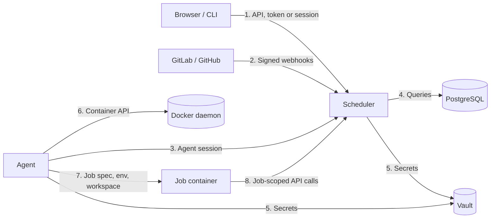

# Threat Model

This document states what Forge is trusted to protect, who it protects it
from, and where the trust boundaries are. It is the reference that security
fixes and reviews are measured against.

!!! warning "Alpha software"
    Forge does not yet meet every objective on this page. The
    [known gaps](#known-gaps) section lists where the implementation falls
    short. Until those are closed, run Forge only on a private network, for
    trusted users, with secrets you can rotate.

---

## Scope and deployment model

Forge is a self-hosted CI/CD system. One organization runs one installation on
infrastructure it controls, and several teams inside that organization share
it. Each team maps to a Forge **org**, which owns projects, secrets, and
policies.

Forge is not designed to be a public, hosted service for mutually hostile
tenants. Teams on one installation are colleagues: they must not be able to
read each other's secrets or tamper with each other's pipelines, but Forge
does not defend against a team mounting a sustained attack on the
installation itself.

The reference deployment is a private network, including environments with
no direct internet access where public hosts resolve to internal mirrors and
TLS is terminated with an internal certificate authority.

---

## Assets

| Asset | Why it matters |
| --- | --- |
| Secrets (registry credentials, deploy keys, SCM tokens) | Direct access to production systems and source code |
| Source code | Checked out by the scheduler and by every job |
| Build outputs (artifacts, container images, releases) | Tampering here reaches every consumer of the build |
| Pipeline integrity (definitions, policies, cache entries) | Decides what code runs with which secrets, and what is reported as passing |
| Agent hosts and their Docker daemons | Jobs execute here; a host compromise exposes every job on it |
| Scheduler, database, and audit log | Control plane and the record of who did what |
| API tokens and user sessions | Stand in for a user or an agent |

---

## Actors

| Actor | Description | Trust |
| --- | --- | --- |
| Outsider | Can reach a network port but holds no credential | None |
| Fork contributor | Can open a merge or pull request from a fork | None. Their pipeline changes are untrusted input |
| Pipeline author | Can push to a repository that Forge builds | Trusted to run code in their own project's jobs, with that project's secrets. Not trusted beyond the project |
| Viewer | Signed-in user with read access | Trusted to read runs, logs, and artifacts they are scoped to |
| Operator | Manages projects, secrets, and runs for a team | Trusted within their org |
| Admin | Runs the installation | Fully trusted |
| Agent | A worker process holding an agent credential | Trusted to execute the jobs it leases and report their results. Not trusted with other agents' jobs |
| Job | Code running inside a step container | Trusted only as far as the pipeline author who wrote it |

Two points follow from this table and drive most of the design:

- **A job is the pipeline author.** Anything a job can reach, anyone who can
  push to that repository can reach.
- **A fork contributor is not a pipeline author.** A pipeline definition that
  arrives in an unmerged fork change is input from an untrusted actor.

---

## Trust boundaries

1. **Client to scheduler.** Every API request is authenticated, authorized
   against a role, and limited to the caller's org and project scope.
2. **SCM to scheduler.** Webhooks are authenticated per project. Fields taken
   from a webhook (refs, commit IDs, repository URLs) are untrusted input.
3. **Agent to scheduler.** Agents authenticate before they can register,
   lease, or report. The channel is encrypted.
4. **Scheduler to database.** The database is reachable only by the scheduler.
5. **Secrets store.** Each component holds the narrowest credential that lets
   it do its work. No component other than the secrets store holds every
   secret.
6. **Agent to container runtime.** Access to a Docker daemon is equivalent to
   root on that host. It is granted to a job only by explicit, per-project
   decision.
7. **Agent to job.** A job receives only what its own step needs: its
   workspace, its declared secrets, and a credential scoped to that one job.
8. **Job to scheduler.** A job's credential cannot read or change anything
   outside its own run.

---

## Security objectives

Forge is meant to guarantee the following. Each line names the actor it
constrains.

1. An **outsider** cannot trigger runs, register as an agent, read any data,
   or crash a component.
2. A **fork contributor** cannot obtain secrets, a Docker socket, or an
   identity token, and cannot change which pipeline definition runs with
   them.
3. A **job** cannot read another project's source, secrets, artifacts, or
   logs, cannot act on another run, and cannot gain control of its agent host
   unless its project has been granted Docker access.
4. A **pipeline author** cannot remove or skip the policies an org applies to
   their pipelines.
5. A **viewer** cannot change state, read secret values, or open a shell on an
   agent.
6. An **operator** cannot act outside their org.
7. A compromised **agent** exposes only the jobs that agent runs, not the
   whole secrets store or other agents.
8. A cache entry or artifact written by an untrusted run cannot be consumed
   as trusted by a later run.
9. Security-relevant actions are recorded in an audit log that the acting
   party cannot alter.

---

## Known gaps

These are the places where the current implementation does not yet meet the
objectives above. They are tracked as the first phase of hardening work and
this table is updated as each one is closed.

| ID | Gap                                                                                                                                                                                                                                                                                                              | Objective | Regression test                                                                                             | Status                                                                                                                                                               |
|----|------------------------------------------------------------------------------------------------------------------------------------------------------------------------------------------------------------------------------------------------------------------------------------------------------------------|-----------|-------------------------------------------------------------------------------------------------------------|----------------------------------------------------------------------------------------------------------------------------------------------------------------------|
| S1 | The agent gRPC session had no authentication and the server had no TLS. Sessions now require an agent token, and TLS is available through `FORGE_GRPC_TLS_CERT` and `FORGE_GRPC_TLS_KEY`                                                                                                                         | 1, 7      | `TestSecurity_S1_AgentSessionRequiresAuthentication`                                                        | Closed. TLS is opt-in; enable it whenever the network between agents and scheduler is not trusted                                                                    |
| S2 | Jobs received the agent's own API token, and agent-facing endpoints did not check the caller's role. Jobs now receive a token scoped to that one job, which can only download its own project's source, and agent endpoints require an agent token | 3, 5 | `TestSecurity_S2_AgentEndpointsRequireAgentRole`, `TestSecurity_S2_JobTokenIsConfined` | Closed. Job tokens expire after 24 hours and are not revoked earlier when a job finishes |
| S3 | Token org and project scope was stored but not enforced. It is now enforced on every route that names its org or project in the URL                                                                                                                                                                              | 3, 6      | `TestSecurity_S3_TokenScopeIsEnforced`                                                                      | Partly closed. Routes addressed by run, job, or artifact ID, list endpoints, and requests that name the org in the body do not check scope yet                       |
| S4 | Runs triggered from fork changes can declare and receive secrets                                                                                                                                                                                                                                                 | 2         | Added with the fix                                                                                          | Open                                                                                                                                                                 |
| S5 | The generic webhook endpoint accepted unauthenticated requests. It now requires the project's webhook secret, as a signature or a token, and validates the branch and commit it is given                                                                                                                         | 1         | `TestSecurity_S5_GenericWebhookRequiresACredential`                                                         | Closed                                                                                                                                                               |
| S6 | Single sign-on provisions any account from the identity provider. Debug sessions did not check the caller's role; they now require the operator role                                                                                                                                                             | 1, 5      | `TestSecurity_S6_DebugSessionsRequireOperator` covers debug sessions; sign-in is tested with its fix        | Partly closed. Debug sessions are guarded; sign-in is still open to any account                                                                                      |
| S7 | Org policies are applied only when the submitter names the org, and before remote templates are expanded                                                                                                                                                                                                         | 4         | Added with the fix                                                                                          | Open                                                                                                                                                                 |
| S8 | The Docker socket proxy failed open and did not inspect container-create requests. It now refuses requests whose target it cannot attribute to the agent, and applies a create policy that blocks privileged mode, host namespaces, added capabilities, host devices, disabled confinement, and host bind mounts | 3         | `TestSecurity_S8_ProxyFailsClosed`, `TestSecurity_S8_ProxyRejectsHostEscapes`                               | Closed for the cases above. Remaining: a job can still name another container in `VolumesFrom`, and containers a job creates are not stamped with the agent's labels |
| S9 | Agents hold a secrets-store credential that can read every secret                                                                                                                                                                                                                                                | 7         | Added with the fix                                                                                          | Open                                                                                                                                                                 |

The regression tests live beside the code they exercise, in files named
`security_*_test.go`. They are part of the default test run, so a change that
reopens a closed gap fails `make test`. Run them on their own with
`make test-security`. Gaps marked "Added with the fix" have no test yet.

---

## Out of scope

- **Hostile tenants on one installation.** See
  [scope](#scope-and-deployment-model).
- **A malicious admin.** Admins can read secrets and change policies by
  design.
- **Compromise of the underlying hosts, the database, or the secrets store**
  by means other than Forge.
- **Supply-chain attacks through the images and dependencies a pipeline
  chooses to use.** Org policies can scan for these, but Forge does not vouch
  for third-party content.
- **Denial of service by an authenticated user**, beyond basic rate and size
  limits.

---

## Keeping this document current

Update this page in the same change as any work that adds an actor, moves a
trust boundary, or closes a known gap. A change that makes one of the security
objectives false is a security bug, even if no exploit is known.
